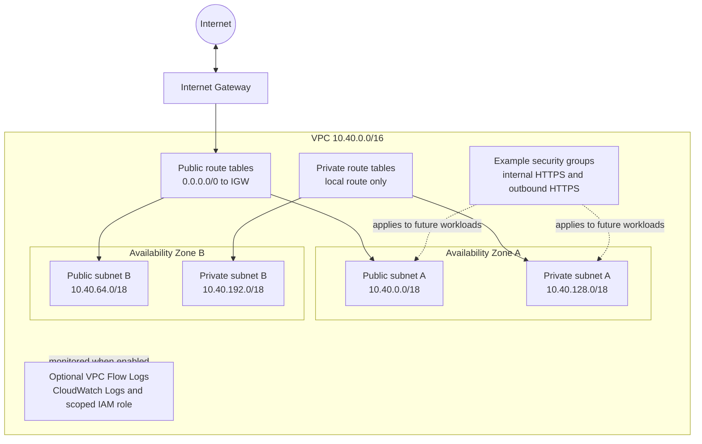

# AWS Secure Network Foundation

A credential-free Terraform reference for a two-Availability-Zone AWS network foundation with deterministic public and private subnets, explicit routing, constrained example security groups, and optional VPC Flow Logs.

This portfolio project demonstrates network design, infrastructure-as-code contracts, security-conscious defaults, automated tests, and static CI. It is intended as a reusable starting point for architecture discussions and future environment-specific implementation, not as a ready-to-run production landing zone.

## Problem

AWS workloads need a predictable network boundary before application services are introduced. This repository addresses that foundation by separating internet-routable and isolated address space across two Availability Zones, making every route and security rule explicit, and keeping optional logging resources behind an opt-in variable.

## Architecture



### Exact topology

The default `10.40.0.0/16` VPC is divided deterministically into four equal `/18` subnets:

| Stable key | Tier | Default CIDR | Public IPv4 assignment | Route-table behavior |
| --- | --- | --- | --- | --- |
| `a` | Public | `10.40.0.0/18` | Enabled | `0.0.0.0/0` through the internet gateway |
| `b` | Public | `10.40.64.0/18` | Enabled | `0.0.0.0/0` through the internet gateway |
| `a` | Private | `10.40.128.0/18` | Disabled | VPC local route only |
| `b` | Private | `10.40.192.0/18` | Disabled | VPC local route only |

AWS permits IPv4 subnet sizes from `/16` through `/28` and reserves five addresses in each subnet. See [Subnet CIDR blocks](https://docs.aws.amazon.com/vpc/latest/userguide/subnet-sizing.html). This module accepts VPC prefixes from `/16` through `/26` so adding two prefix bits always produces four AWS-valid subnets.

## Routing and egress behavior

- Each public subnet has its own route table and a default IPv4 route through the VPC internet gateway. Public reachability still depends on workload addressing, security groups, network ACLs, and application configuration.
- Each private subnet has its own route table with only the AWS-created local VPC route. Private workloads have no internet egress from this implementation.
- No NAT gateway, NAT instance, transit gateway, VPC endpoint, load balancer, VPN, or Direct Connect resource is created.
- A production design that needs private-subnet egress should add an explicitly approved pattern, normally zonal NAT gateways or suitable VPC endpoints, plus route tests and failure-domain analysis.

NAT gateways are intentionally excluded and therefore incur no NAT Gateway charges from this configuration. AWS charges provisioned NAT gateways per gateway-hour and per gigabyte processed, with possible cross-Availability-Zone transfer implications. Review the current [NAT gateway pricing guidance](https://docs.aws.amazon.com/vpc/latest/userguide/nat-gateway-pricing.html) before adding them. Prices vary by Region and usage, so this repository makes no cost estimate or savings claim.

## Security design

- Public subnets auto-assign public IPv4 addresses; private subnets do not.
- Automatic public IPv4 assignment is limited to the two public subnets. A public address and internet-gateway route do not alone permit traffic: security groups, network ACLs, and workload listeners must also allow it. Production environments should disable automatic assignment unless direct public addressing is explicitly required and reviewed.
- The `internal_https` example security group permits TCP 443 ingress only from the configured VPC CIDR and TCP 443 egress to IPv4 destinations.
- The `outbound_https` example security group has no ingress rule and permits only TCP 443 egress to IPv4 destinations.
- Both example egress rules use `0.0.0.0/0`, but only for TCP 443. This remains a material exfiltration and supply-chain risk. Production policy should narrow destinations with approved AWS-managed prefix lists, VPC endpoints, network inspection, or controlled proxy addresses.
- These groups are examples, not complete workload policy. Production use requires application-specific sources, destinations, ports, IPv6 decisions, network ACL review, threat modeling, and compliance validation.
- Terraform state can contain sensitive infrastructure metadata. Use an encrypted, access-controlled remote backend with locking before any team or production deployment.

## Optional VPC Flow Logs and IAM

`enable_flow_logs` defaults to `false`. When enabled, the module creates a VPC-level flow log for accepted and rejected traffic, a CloudWatch log group with 30-day retention, and a delivery role. The inline role policy limits stream creation and event publication to the dedicated log group. The trust policy limits assumption to the VPC Flow Logs service and uses `aws:SourceAccount` plus `aws:SourceArn` conditions to reduce confused-deputy risk, following AWS guidance for [publishing flow logs to CloudWatch Logs](https://docs.aws.amazon.com/vpc/latest/userguide/flow-logs-iam-role.html).

Flow Logs are not real-time packet capture and do not inspect payloads. Enabling them can generate CloudWatch ingestion, storage, and query charges. Retention, encryption, access, alerting, and centralization must be designed for the target environment.

## Technologies

- Terraform `>= 1.7.0`
- HashiCorp AWS provider `~> 6.0`
- Terraform native tests with a mocked AWS provider
- TFLint and Trivy configuration scanning
- GitHub Actions and Dependabot
- Mermaid architecture documentation

## AWS prerequisites for a future deployment

Local validation needs no AWS account or credentials. A future plan or deployment would require, at minimum:

1. An AWS account and an intentionally selected Region.
2. Two valid and distinct Availability Zones in that Region.
3. An authenticated AWS identity with least-privilege permissions for the VPC, subnet, route, internet gateway, security-group, and optional CloudWatch Logs/IAM resources in this repository.
4. An approved remote-state, encryption, locking, naming, tagging, cost, logging, and change-management design.
5. Independent architecture and security review, plus a tested rollback procedure.

Do not use long-lived credentials in Terraform files, variable files, shell history, or GitHub repository secrets. Prefer short-lived federation for any separately approved deployment workflow.

## Credential-free validation

The repository lock file is committed. Run the same read-only checks used by CI from the repository root:

```powershell
terraform fmt -check -recursive
terraform init -backend=false -lockfile=readonly -input=false
terraform validate -no-color
terraform test -no-color

terraform -chdir=examples/basic init -backend=false -input=false
terraform -chdir=examples/basic validate -no-color

tflint --init --config "$PWD/.tflint.hcl"
tflint --config "$PWD/.tflint.hcl" --format compact
tflint --config "$PWD/.tflint.hcl" --format compact --recursive

trivy config --severity HIGH,CRITICAL --exit-code 1 --skip-dirs .terraform --skip-dirs .tools .
```

These commands initialize providers, validate configuration, execute mocked tests, lint Terraform, and scan configuration. They do not authenticate to AWS and do not run `terraform plan` or `terraform apply`.

## Basic example

[`examples/basic/main.tf`](examples/basic/main.tf) calls the root module with:

- VPC CIDR `10.40.0.0/16`
- Availability Zones `us-east-1a` and `us-east-1b`
- VPC Flow Logs disabled

The Availability Zone names are documentation-safe reference values. Confirm that chosen zones exist and are appropriate for the target account and Region before any future deployment.

## Outputs

| Output | Description |
| --- | --- |
| `vpc_id` | Created VPC ID |
| `public_subnet_ids` | Two public subnet IDs ordered by stable key |
| `private_subnet_ids` | Two private subnet IDs ordered by stable key |
| `security_group_ids` | Map containing the `internal_https` and `outbound_https` example security-group IDs |

## Limitations

- IPv4 only. No IPv6 CIDR, egress-only internet gateway, or IPv6 security rules.
- Exactly two Availability Zones and four equal subnets.
- No NAT, VPC endpoints, centralized inspection, DNS Resolver endpoints, peering, transit, hybrid connectivity, workload resources, or application deployment.
- No remote backend, organizational controls, SCPs, permission boundaries, customer-managed KMS keys, CloudTrail, AWS Config, GuardDuty, monitoring alarms, or incident automation.
- Example security groups and default tags need environment-specific refinement.
- The public tier intentionally enables automatic public IPv4 assignment, and the example security groups intentionally permit TCP 443 egress to `0.0.0.0/0`. Resource-scoped Trivy exceptions document these design risks. Production adoption should remove or narrow them.
- CI validates configuration with mocked providers. It cannot prove AWS quotas, permissions, deployability, runtime connectivity, performance, resilience, or cost.

## Verification and deployment status

No AWS deployment was performed. No AWS resource was created, no live network path was tested, and no actual AWS cost result was produced. Local and hosted workflows are designed only for credential-free formatting, initialization, validation, mocked tests, linting, and configuration scanning.

## Maintenance status

Maintained as a portfolio and consultancy reference on the default branch. Changes should preserve credential-free validation, explicit cost boundaries, least-privilege examples, pinned CI dependencies, and tested input/output contracts. See [CONTRIBUTING.md](CONTRIBUTING.md) and [SECURITY.md](SECURITY.md).

## License

Licensed under the [MIT License](LICENSE).
